# 泥深 · Your SZU Life

你的深大，你的生活！

当前功能最全、支持平台最多的SZU常用功能合集优化。

[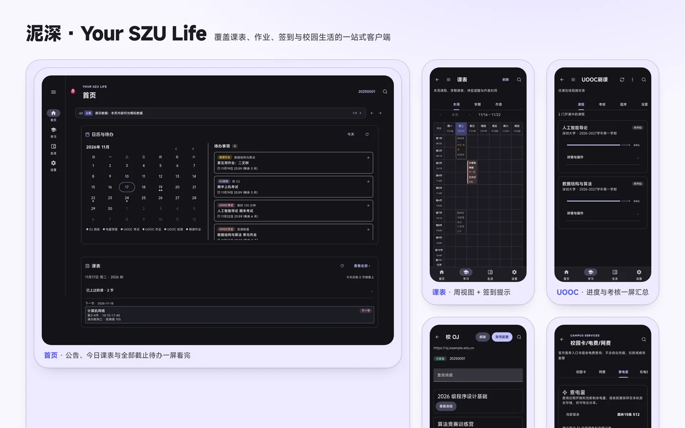](demos/showcase.webp)

## 能做什么

### 首页

一屏看完今天还剩什么：公告横条、今日课表与全部平台的截止待办。

- 课表与待办两张卡片按时段自动换位——课没上完时课表在前，下课后待办优先。
- lms 作业、UOOC 考核与 OJ 测验统一收进日历，重叠时按紧急度排序。

### 学习

- **课表**：本周课程、学期课表与作息表三视图；课程按课程着色，已上完的自动淡出，当前节次高亮，并直接标出需要签到的课。
- **OJ**：支持计软合集 OJ，自动过验证码、可自定义 OJ、CPH-NG 联动、Markdown 导出；题面、样例与在线判题在同一页完成。
- **UOOC 刷课**：自动签到、题库匹配、AI 答题与进度检查，进度与考核在同一个面板汇总。
- **签到 / 打卡**：畅课与 SZU 考勤，支持数字、雷达（定位）、二维码与拍照签到，并可配置自动化。
- **畅课 lms**：课程待办与站内通知集中管理，未读数一眼可见。
- **监察巡课**：课程直播与录播回放的前端集成，支持本地下载管理。
- **选课**：查课、抢课与选课期间的课表预览，选课前先做培养方案检查。
- **学业完成查询**：培养方案、学分与课程完成情况逐项对照。

### 生活

- **校园网登录**：区分教工区与宿舍区，可配置自动登录选项；支持校内与校外两种网络环境。
- **校园卡与缴费**：电费、网费快捷入口，充电费与网费直接打开官方页面。
- **电量查询**：用量走势、余额预测与欠费提醒，数据来自真实读数窗口。

### 设置

- **外观**：种子色驱动的 Material 3 主题，深浅色跟随系统或手动指定；Android 端可跟随壁纸取色。
- **通知**：各类提醒统一在一处开关，后台轮询按前台 / 功能页 / 后台三档自动调整节拍。
- **同步**：多台设备之间同步设置、题库与账号凭据，走设备自组网；跨网时经各设备自己的公共中继实例转发，中继只转发端到端加密的密文。
- **MCP**：本地 MCP 服务把业务能力开放给外部大模型客户端或内置智能体。

## 界面预览

首页与学习、生活的四个主入口（宽屏为侧边导航，窄屏为底部导航，图为手机界面）：

| 首页                                                      | 学习                                                       | 生活                                                      | 设置                                                          |
| --------------------------------------------------------- | ---------------------------------------------------------- | --------------------------------------------------------- | ------------------------------------------------------------- |
| 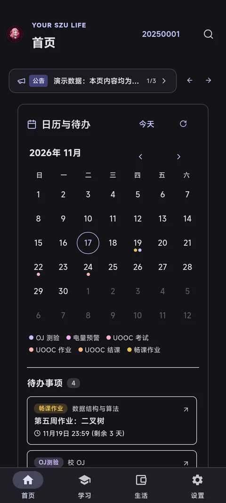 | 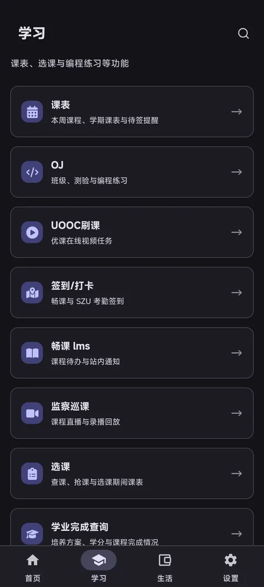 | 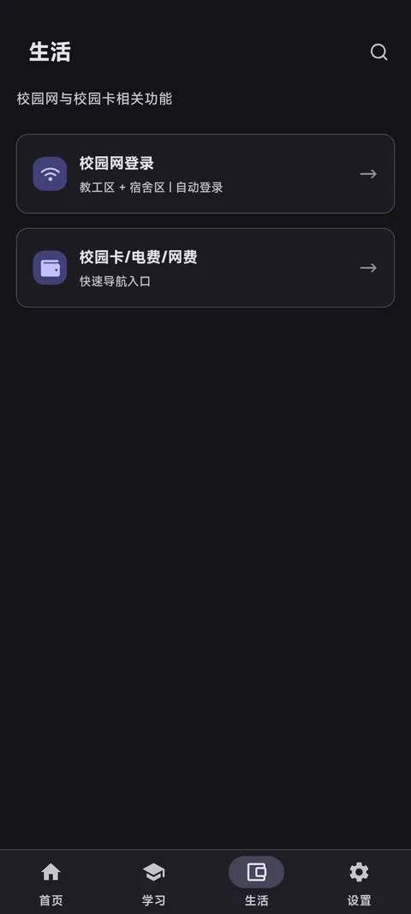 | 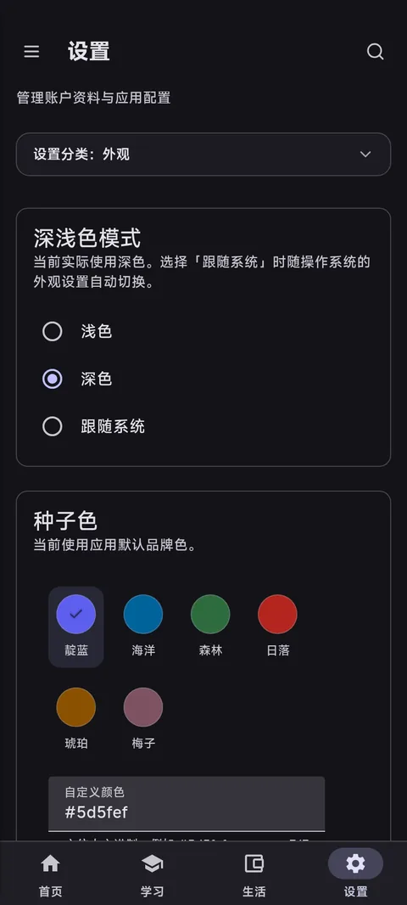 |

课表、签到与作业：

| 课表                                                           | 签到 / 打卡                                                 | 畅课 lms                                                     |
| -------------------------------------------------------------- | ----------------------------------------------------------- | ------------------------------------------------------------ |
| 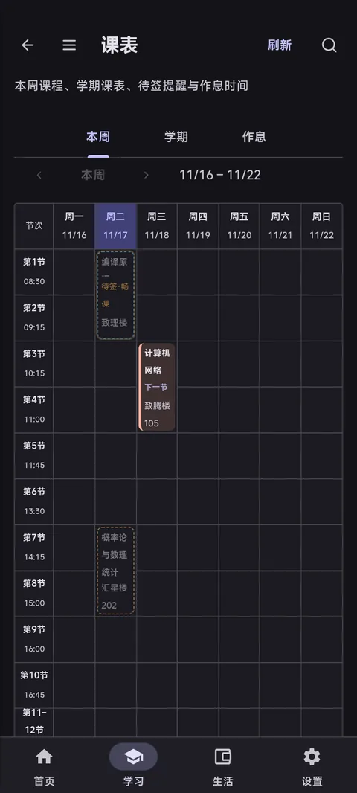 | 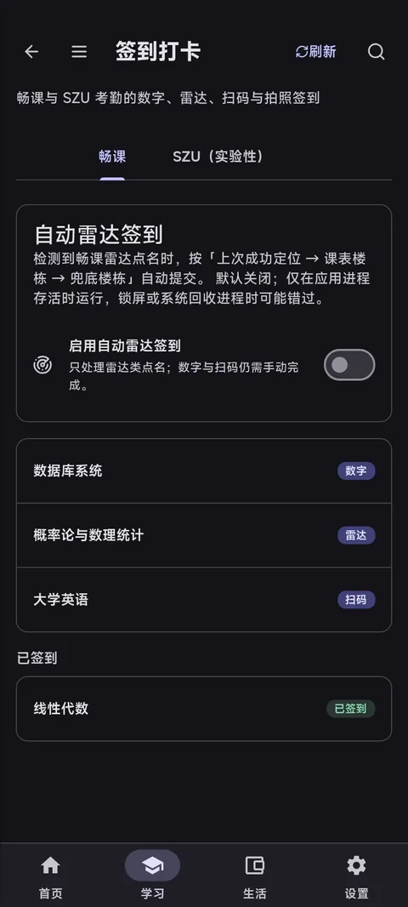 | 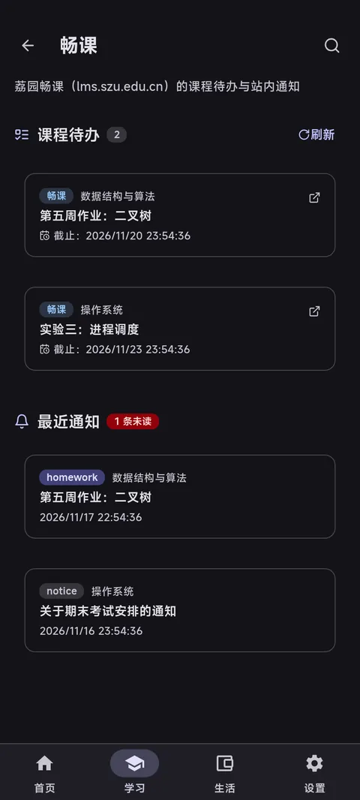 |

学习模块与校园服务：

| UOOC                                                      | OJ                                                    | 选课                                                            | 校园网                                                         | 电量                                                             |
| --------------------------------------------------------- | ----------------------------------------------------- | --------------------------------------------------------------- | -------------------------------------------------------------- | ---------------------------------------------------------------- |
| 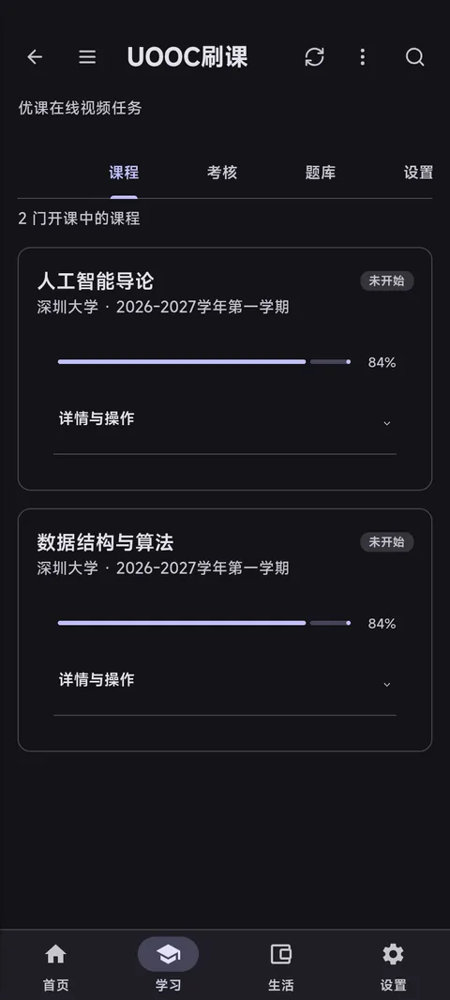 | 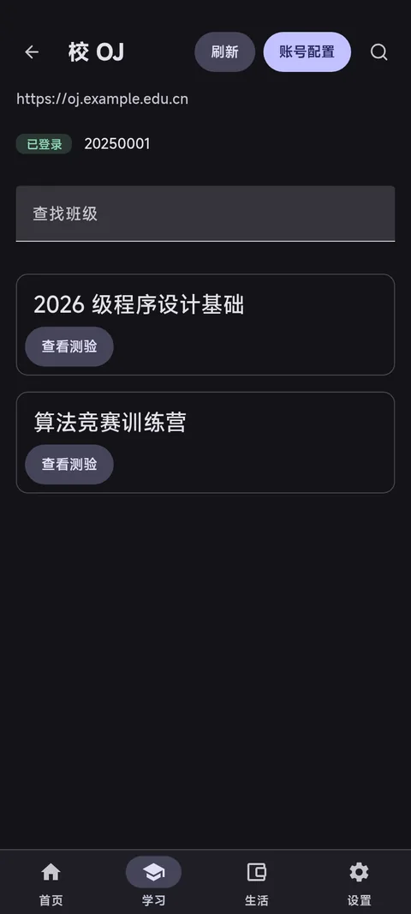 | 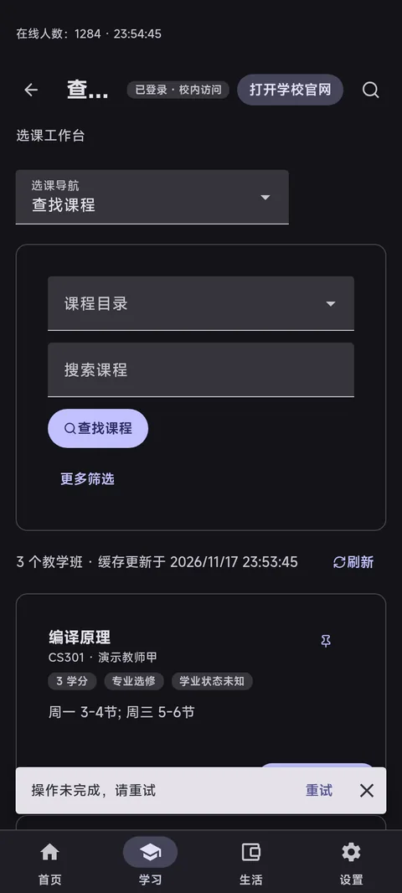 | 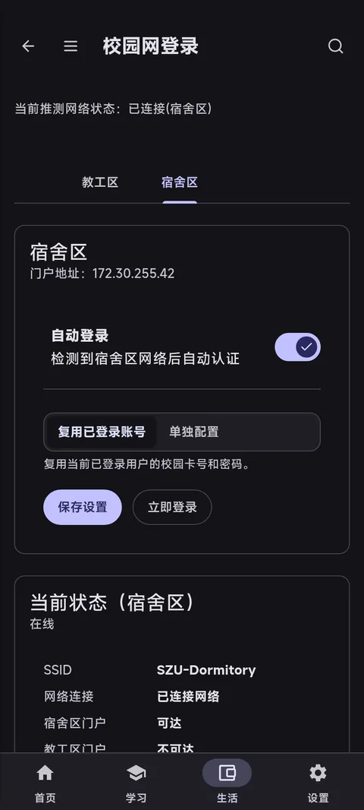 | 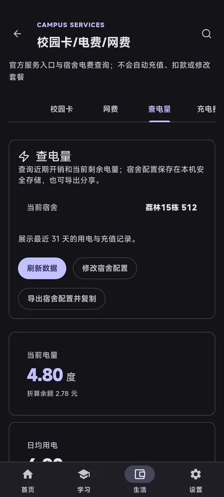 |

宽屏下换成侧边导航加多列布局，点开看大图：[首页](demos/home-desktop.webp) ·
[学习](demos/study-desktop.webp) · [课表](demos/timetable-desktop.webp) ·
[签到](demos/signin-desktop.webp) · [UOOC](demos/uooc-desktop.webp) ·
[OJ](demos/oj-desktop.webp) · [选课](demos/enrollment-desktop.webp) ·
[畅课](demos/lms-desktop.webp) · [生活](demos/life-desktop.webp) ·
[校园网](demos/network-desktop.webp) · [电量](demos/electricity-desktop.webp) ·
[设置](demos/settings-desktop.webp)。

> 以上图片均来自演示模式，课程、成绩、账单与提交记录全部是虚构数据。

## 安装

Windows、Android、Linux 全平台支持。下载地址：

- GitHub Releases：<https://github.com/rinnein/your-szu-life/releases/tag/canary>
- CNB 镜像站（国内访问更快）：<https://cnb.cool/rinnein/szu/your-szu-life/-/releases>

### ArchLinux

```bash
yay -S your-szu-life
# or
paru -S your-szu-life
```

## 正在迭代

以下功能在快速迭代中，暂不保证稳定性：UOOC AI 答题、UOOC 答案共享、选课抢课、MCP 支持。

尚未实现：

- [ ] OJ 助教自动批改
- [ ] OJ 自动 AI 样例扩展

## 隐私与技术

- 所有数据只存在本机；账号凭据保存在系统密钥环，不写入配置文件。
- MCP 服务只监听本机回环地址；设备同步的虚拟组网由本机常驻公共中继实例开放 3 个入站端口，数据经中继转发但端到端加密，中继看不到明文。
- 构建与检查的具体约定见 [AGENTS.md](AGENTS.md)。

## 字体

界面默认使用小米 MiSans（经 npm 包 [`misans`](https://github.com/dsrkafuu/misans) 引入其按 unicode-range
切片子集化的可变字重版本），依据《MiSans 字体知识产权许可协议》在软件中标注使用，许可说明见
`src-tauri/resources/licenses/misans.txt`。

代码与等宽场景（OJ 编辑器、样例输入框、日志）使用 Monaspace Neon
（[githubnext/monaspace](https://github.com/githubnext/monaspace)，OFL-1.1），许可见
`src-tauri/resources/licenses/monaspace-neon.txt`。
